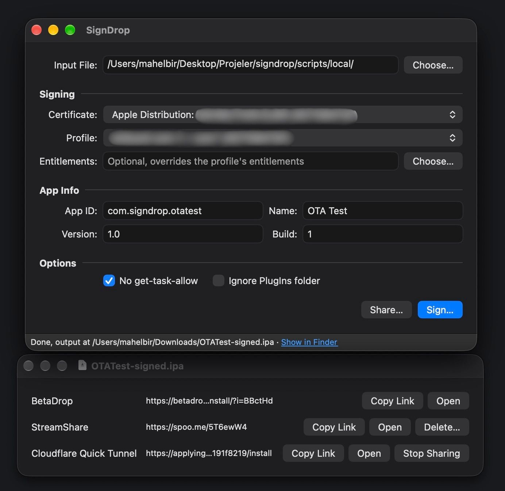

# SignDrop

[](https://github.com/mahelbir/signdrop/releases)
[](LICENSE.txt)

A macOS app that re-signs iPhone and iPad apps with your own certificate and provisioning profile, and shares the signed IPA as an
install link.



## Features

- Re-signs iOS and iPadOS apps from `.ipa`, `.app`, `.appex` and `.xcarchive` files, jailbreak `.deb` packages that contain an
  app, or an IPA URL
- Uses any signing certificate in your Keychain with an installed or custom provisioning profile
- Overrides the profile's entitlements with your own file
- Changes the App ID, display name, version and build before signing
- Signs extensions, frameworks and libraries inside out, then verifies the result
- Can leave out the `get-task-allow` entitlement and skip re-signing the `PlugIns` folder
- Takes input files, IPA URLs and provisioning profiles by drag and drop
- Remembers your certificate, profile and options between launches
- Shares the signed IPA to several services at once, or straight from your Mac, and provides the install links

## How to Install

Download the latest `.dmg` from [Releases](https://github.com/mahelbir/signdrop/releases), open it and drag
**SignDrop** into **Applications**.

> **Note:** SignDrop needs macOS 12 or later and the Xcode command line tools.

## How to Update

SignDrop checks [Releases](https://github.com/mahelbir/signdrop/releases) and opens the release page when a new
version is out. To update, download the new `.dmg` and drag **SignDrop** into **Applications** again.

## How to Build

```bash
git clone https://github.com/mahelbir/signdrop.git
cd signdrop
scripts/run.sh
```

`scripts/run.sh` builds a Debug copy with Xcode and launches it. To update a source build, pull the latest changes and
run the script again.

> **Note:** Building SignDrop needs Xcode 26 or later.

## Sharing

After signing an IPA, click **Share…** next to **Sign…** to open its share window. Each service has its own row, so
you can start several at once and follow each one's progress. **Cancel** stops a running share, **Retry** repeats a
failed one, and your Mac stays awake while a share runs.

A finished row shows the install link with **Copy Link** and **Open**. To install the app, open that link in Safari on
an iPhone or iPad listed in the provisioning profile.

For Streamshare and Cloudflare Quick Tunnel, right-click **Copy Link** to copy the raw `itms-services` link.

| Service                 | Requirements                              | Link                                            |
|-------------------------|-------------------------------------------|-------------------------------------------------|
| BetaDrop                | BetaDrop account, sign in from SignDrop   | BetaDrop install page                           |
| Streamshare             | None                                      | Short link that opens the install prompt        |
| Cloudflare Quick Tunnel | `cloudflared` installed on your Mac       | Link served from your Mac that opens the prompt |

**BetaDrop** signs you in through your browser, or with a pasted API token. SignDrop shares its session with the
[BetaDrop CLI](https://github.com/betadrop-app/betadrop-cli), so signing in to one signs in the other. Sign out from
the app menu.

**Streamshare** uploads the IPA and an install manifest, then builds a short link.

> **Important:** Files on Streamshare are public to anyone with the link. Click **Delete…** in the share window to
> remove them, or right-click it to copy a Terminal command that removes them later.

**Cloudflare Quick Tunnel** keeps the IPA on your Mac and serves it through a temporary public address, so nothing is
uploaded. SignDrop shows how to install `cloudflared` if it is missing.

> **Important:** The link works only while SignDrop is sharing. Click **Stop Sharing** in the share window to end it.
> Closing that window or quitting SignDrop asks first, then stops sharing.

## Credits

SignDrop is based on [iOS App Signer](https://github.com/DanTheMan827/ios-app-signer) by Daniel Radtke. BetaDrop uploads
follow the official [BetaDrop CLI](https://github.com/betadrop-app/betadrop-cli).

Install links are hosted by [Streamshare](https://streamshare.wireway.ch), turned into web links by
[Urlmskr](https://axorax.github.io/urlmskr/), and shortened by [Ulvis](https://ulvis.net),
[Spoo.me](https://spoo.me), [CleanURI](https://cleanuri.com) or [TinyURL](https://tinyurl.com).

Shares from your Mac run through [Cloudflare Quick Tunnel](https://try.cloudflare.com).

SignDrop is not affiliated with these services.

## Support

If this project helps you, please consider giving it a [Star ⭐️](https://github.com/mahelbir/signdrop) on GitHub.
This will encourage us to continue developing and maintaining this project.
